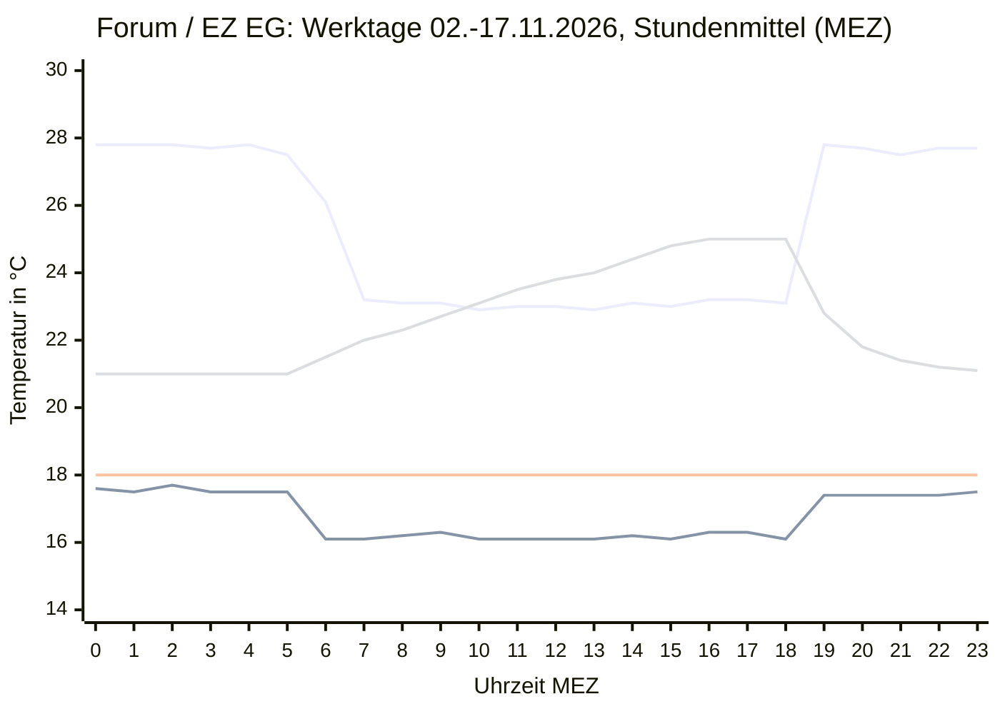

# KI-Ergebnis A163: Trendaufzeichnung Forum – Lüftung oder Heizung

- **Projekt:** A163, Kette „Forum zu warm“, Schritt 1 von 2 [A163_Trendaufzeichnung_Forum_Lueftung_oder_Heizung.pdf, S. 1, Kopf]
- **Runde:** 1 (Teilergebnis, Status „Infos benötigt“)
- **Datum:** 20.11.2026
- **Federführend:** Elena Voss (Person 4), beteiligt Personen 1, 2, 5 [data/site.json, Projekt A163]
- **Fristen:** Stellungnahme an Thermenfeld bis 25.11. in Uebergaben/K64; Antwort Thermenfeld bis 30.11. in K64; Angebot Signalsteg bis 27.11. in K64; Antwort an Signalsteg bis 30.11. in K64 [A163_…pdf, S. 2, „Übergabe“; 00_Bis_zum_2_12.md, Zeilen 15, 19, 20]
- **Rechentabelle:** `KI_Ergebnis_A163_v1.csv` (Zeitraummittel, Tageswerte, Tagesgang; mit Python aus der Trend-CSV, Trennzeichen Semikolon)
- **Abkürzungen in den Quellen:** „Trend-CSV“ = Trend_EZ_EG_Forum_2026-10-26_bis_2026-11-17.csv (Person_4/03_Material/GA). Zeilenangaben = Zeilennummer in dieser Datei (Zeile 6 = Spaltenköpfe, Zeile 7 = erster Messwert 26.10. 00:00 UTC).

## Vorbemerkung

- Die Aufgabe ordnet zu: **Abgeben** Diagramm aus der CSV; **Teilen** Prüfung der Datei und Auswertung der Zeitreihe; **Behalten** Ursache, Sofortmaßnahme, Zuständigkeit und Ton gegenüber Thermenfeld [A163_…pdf, S. 2, „Einsatz von KI“]. Abschnitte 1.1–1.3 sind deshalb ausgearbeitet. Ursache, Stellungnahme, Sofortmaßnahme und Antwort an Signalsteg stehen als **Vorschlag mit Begründung** da. Elena entscheidet.
- **Zeitzone:** Die Zeitstempel sind UTC [Trend-CSV, Zeile 3]. Im ganzen Zeitraum gilt MEZ = UTC + 1 Stunde (Sommerzeit endete am 25.10.2026) [Annahme, Kalender]. 17:00 UTC ist also 18:00 Uhr Ortszeit.
- **Einheiten:** Der Ist-Volumenstrom steht in l/s, der Sollwert in m³/h [Trend-CSV, Zeile 6, Spalten `VSR_Forum_Ist_l_s` und `VSR_Forum_Soll_m3_h`]. Umgerechnet wird mit 1 l/s = 3,6 m³/h [Rechnung].

---

## 1 Ergebnis

### 1.1 Prüfung der Datei vor dem Rechnen (Liste der Auffälligkeiten)

| Nr. | Zeile(n) | Auffälligkeit | Behandlung |
|---|---|---|---|
| 1 | 6 | Ist-Volumenstrom in **l/s**, Soll in **m³/h**. Wer die Spalten direkt vergleicht, liest „145 von 1.080“ oder „306 von 1.080“ und schließt falsch auf Luftmangel. | Ist × 3,6 umgerechnet. Ergebnis: vor dem Tausch ≈ 519 m³/h, danach ≈ 1.101 m³/h [Rechnung, CSV Teil „Zeitraum“ A und B]. Passt zu „vorher 520 m³/h“ und „1.110 m³/h“ [Firmenbriefing, S. 13, Abschnitt 18, Eintrag 30.10.2026; Postfach Nr. 16]. |
| 2 | zwischen 270 und 271 | **12 Stunden fehlen**: 06.11.2026 00:00 bis 11:00 UTC. Erwartet sind 23 Tage × 24 = 552 Werte, vorhanden sind 540 [Python-Prüfung der Zeitfolge]. | Nicht aufgefüllt. Tageswert 06.11. nur aus 6 Betriebsstunden (Zeilen 271–276), in der CSV vermerkt. Ursache der Lücke **nicht belegt** (Export, Station oder Netzwerk); im Kopf steht dazu nichts [Trend-CSV, Zeilen 1–4]. |
| 3 | 358 | `RT_Forum_degC` = **85,0** am 10.11. 03:00 UTC, davor und danach 21,0–21,1 °C, Anlage aus [Trend-CSV, Zeilen 357–359]. Physikalisch nicht möglich, Einzelwert. | Aus allen Mittelwerten der Raumtemperatur ausgeschlossen (Messfehler oder Ersatzwert der Station [Annahme]). |
| 4 | 7–546 | `EZEG_Zuluft_Soll_degC` steht durchgehend auf **18,0** [Trend-CSV, alle Zeilen; Python: min = max = 18,0]. | Kein Fehler, aber wichtig: Der Regler will 18 °C, misst 23 °C und gibt **0 %** aus. Das ist die Kernbeobachtung (1.2). |
| 5 | Stillstandszeiten, z. B. 7–11, 25–35 | Bei Ventilator aus (`VSR_Forum_Soll` = 0, Ist = 0,0) zeigt `EZEG_Zuluft_nach_LE_degC` 27–28 °C. Der Fühler misst dann stehende Luft am Register. | Für die Bewertung der Zulufttemperatur nur Betriebsstunden verwendet. Stillstandswerte getrennt ausgewiesen (Zeitraum D/E), weil sie zeigen, dass das Register auch ohne Stellsignal warm ist. |
| 6 | 05:00-UTC-Zeilen, z. B. 12, 36, 180, 504 | Nur in der ersten Betriebsstunde öffnet das Ventil (Stellsignal 18–24 %, Rückmeldung gleich ±1 %) [Trend-CSV; Python-Liste aller Zeilen mit Stellsignal > 0]. | Als „Anfahrstunde“ (Zeitraum C) getrennt. Nicht in den Mittelwerten der Ventil-0-%-Stunden. |
| 7 | 113 | Sprung des Ist-Volumenstroms am 30.10. von 140,6 l/s (Zeile 112, 09:00 UTC) auf 306,6 l/s (Zeile 113, 10:00 UTC). | Kein Fehler: Tausch des Stellantriebs am 30.10. [Firmenbriefing, S. 13; Personenbriefing Elena Voss, S. 3, Abschnitt 11]. Trennt die Zeiträume A und B. |
| 8 | alle | Stellsignal und Rückmeldung des Ventils weichen nie um mehr als 1 %-Punkt ab [Python]. | Signalweg Stellsignal → Antrieb plausibel; ob das Ventil dahinter dicht ist, zeigt die Rückmeldung **nicht** (siehe 1.2). |
| 9 | 4 | Export „EVo Servicenotebook“, Objekt „Bogenfeld 12“ [Trend-CSV, Zeilen 2 und 4]. | Adresse stimmt mit dem Haus überein [Firmenbriefing, S. 3, Abschnitt 6]. Keine weitere Behandlung. |

Sonst ist nichts aufgefallen: alle 540 Zeilen haben 10 Spalten, alle Werte sind Zahlen, keine doppelten Zeitstempel [Python-Prüfung].

### 1.2 Auswertung

**Welche Spalten die Frage entscheiden und warum**

| Frage | entscheidende Spalten | Begründung |
|---|---|---|
| Volumenstrom? | `VSR_Forum_Ist_l_s` (× 3,6) gegen `VSR_Forum_Soll_m3_h` | direkter Ist/Soll-Vergleich nach dem Tausch |
| Zulufttemperatur nach dem Lufterhitzer? | `EZEG_Zuluft_vor_LE_degC`, `EZEG_Zuluft_nach_LE_degC`, `EZEG_Zuluft_Soll_degC`, `EZEG_LE_Ventil_Stellsignal_%`, `EZEG_LE_Ventil_Rueckmeldung_%` | Erwärmung über dem Register bei geschlossenem Ventil zeigt, ob Wärme durchkommt, die die Regelung nicht will |
| Heizwasserseite? | `HK_EZEG_Vorlauf_degC` | einzige Spalte zur Wasserseite; Rücklauf, Differenzdruck und Pumpe sind **nicht aufgezeichnet** [Trend-CSV, Zeile 6] |
| Wirkung im Raum | `RT_Forum_degC` | Folge, nicht Ursache |

**Zeitraummittel** (Quelle: CSV Teil „Zeitraum“; Rechnung mit Python)

| Zeitraum | Zeilen | Stunden | Ventil Stell/Rückm. % | Zuluft vor LE °C | Zuluft nach LE °C | Erwärmung K | Soll °C | Vorlauf °C | Volumenstrom m³/h (Soll 1.080) | RT Mittel / Max °C |
|---|---|---|---|---|---|---|---|---|---|---|
| A vor Tausch, 06–17 UTC | 13–112 (Auswahl) | 52 | 0,0 / 0,0 | 16,1 | 23,1 | **6,9** | 18,0 | 55,5 | **519** (48 %) | 24,1 / 26,1 |
| B nach Tausch, 06–17 UTC | 113–540 (Auswahl) | 146 | 0,0 / 0,0 | 16,2 | 23,1 | **6,9** (6,4 bis 7,4) | 18,0 | 55,4 | **1.101** (102 %) | 23,9 / 25,9 |
| C Anfahrstunde 05 UTC | 12 … 528 | 16 | 21,4 / 21,7 | 16,1 | 26,2 | 10,1 | 18,0 | 55,6 | 915 | 21,5 |
| D Werktagnacht, Anlage aus | 7 … 546 | 131 | 0 / 0 | 17,5 | 27,7 | 10,2 | 18,0 | 45,7 | 0 | 21,1 (ohne Z. 358) |
| E Wochenende, Anlage aus | 127 … 498 | 144 | 0 / 0 | 17,5 | 27,8 | 10,2 | 18,0 | 56,4 | 0 | 20,4 |

**Diagramm: Tagesgang Werktage 02.–17.11.2026 (Ortszeit MEZ, Mittel je Stunde, 11–12 Werte je Punkt)** [CSV Teil „Tagesgang“; Trend-CSV Zeilen 175–546, Werktage, ohne Zeile 358]

Linien von oben: (1) Zuluft **nach** Lufterhitzer, (2) Zuluft **vor** Lufterhitzer, (3) Zuluft-**Soll** 18 °C, (4) Raumtemperatur Forum. Ventil-Stellsignal: 21 % nur um 6 Uhr MEZ, sonst **0 %** (Betrieb 6–18 Uhr). Für die Folie (Abgeben) kann die Gruppe das Diagramm aus der CSV als PNG erzeugen; die Werte stehen in `KI_Ergebnis_A163_v1.csv`, Teil „Tagesgang“.

**Aussagen mit Spalte, Zeitraum und Zeilen**

1. **Der Volumenstrom ist seit 30.10. in Ordnung.** `VSR_Forum_Ist_l_s` im Betrieb vor dem Tausch 144,0 l/s ≈ 519 m³/h (26.–30.10., Zeilen 12–112), danach 305,9 l/s ≈ 1.101 m³/h bei Soll 1.080 (30.10. 10:00 bis 17.11., Zeilen 113–540) [Trend-CSV; Rechnung]. **Belegt durch die Datenreihe.**
2. **Hinter dem Lufterhitzer ist die Luft rund 7 K wärmer als davor, obwohl Stellsignal und Rückmeldung 0 % zeigen.** In allen 146 Betriebsstunden nach dem Tausch mit Ventil 0 % liegt `EZEG_Zuluft_nach_LE_degC` bei 23,1 °C im Mittel, `EZEG_Zuluft_vor_LE_degC` bei 16,2 °C, Soll 18,0 °C; die Differenz schwankt nur zwischen 6,4 und 7,4 K (Zeilen 113–540, je 06–17 UTC) [Trend-CSV; Python]. Vor dem Tausch dasselbe Bild: 6,9 K (Zeilen 13–112). **Belegt durch die Datenreihe.** Rechnerisch bringt das rund **2,5 kW** Wärme ins Forum, die die Regelung nicht anfordert (1.101 m³/h × 1,2 kg/m³ × 1,005 kJ/(kg K) × 6,9 K / 3.600) [Rechnung; Luftdichte und Wärmekapazität Annahme].
3. **Auch bei stehendem Ventilator ist das Register warm.** Nachts und am Wochenende, Ventil 0 %, Anlage aus: Zuluft nach LE 27,7–27,8 °C, vor LE 17,5 °C (Zeiträume D und E) [Trend-CSV; Python]. **Belegt durch die Datenreihe**, dass am Register Wärme ankommt. Auffällig: Der Wert folgt dem nächtlichen Absenken des Vorlaufs von ≈ 55 auf ≈ 46 °C (20–03 UTC) **nicht** (CSV Teil „Tagesgang“). Das muss die Prüfung vor Ort erklären (siehe 4.).
4. **Was die Datenreihe nicht entscheiden kann:** ob das Ventil durchlässt (Sitz undicht, Antrieb fährt nicht ganz zu, Ventil falsch herum eingebaut), ob ein Bypass oder eine Schwerkraftzirkulation Wärme durchlässt, oder ob der Fühler `Zuluft_nach_LE` falsch misst oder falsch zugeordnet ist. Für eine echte Erwärmung spricht, dass die Raumtemperatur im Betrieb von 21,5 auf 25,0 °C steigt (Tagesgang, 6–18 Uhr MEZ) und nach Betriebsende sofort fällt (z. B. Zeilen 192→193: 25,0 → 22,9 °C, 17:00 → 18:00 UTC am 02.11.) [Trend-CSV]. Ein **Fühlerfehler ist damit aber nicht ausgeschlossen** [Vermutung]. Elenas eigene Regel aus dem 16.09.2026 („zuerst fragen, ob der Fühler stimmt“) gilt auch hier [Personenbriefing Elena Voss, S. 3, Abschnitt 11].
5. **Heizwasserseite:** `HK_EZEG_Vorlauf_degC` folgt jeden Tag, auch am Wochenende, demselben Muster: ≈ 55 °C von 04:00 bis 19:00 UTC, ≈ 46 °C nachts (Zeilen 7–546; CSV Teil „Tagesgang“). Vor und nach dem Tausch gleich (55,5 / 55,4 °C, Zeiträume A/B). **Kein Hinweis aus der Datenreihe**, dass sich an der Wasserseite etwas geändert hat. Ein zu hoher Differenzdruck, der ein Ventil aufdrückt, wäre in dieser Aufzeichnung **nicht sichtbar**, weil Druck und Rücklauf fehlen [Trend-CSV, Zeile 6]. Das ist die einzige Frage, die Thermenfeld sinnvoll beantworten kann.
6. **Raumtemperatur:** nachmittags im Mittel 25,0 °C um 16–18 Uhr MEZ nach dem Tausch, Maximum 25,9 °C am 12.11. 15:00 UTC (Zeile 418); vor dem Tausch bis 26,1 °C (27.10. 17:00 UTC, Zeile 48) [Trend-CSV; CSV Teil „Tag“]. Der Tausch hat das Forum um etwa 1 K entlastet, die Erwärmung am Register aber nicht beseitigt.

**Kurzurteil der Auswertung (Vorschlag, Behalten):** Nicht der Volumenstrom (behoben), sondern die **Zulufttemperatur nach dem Lufterhitzer der Etagenzentrale EG**: Wärme bei Ventil 0 %. Ob Ventil, Antrieb oder Fühler, ist eine Vermutung, die nur eine Prüfung vor Ort klärt. Die Heizwasserseite ist nach der Datenreihe unauffällig, aber nicht vollständig aufgezeichnet.

### 1.3 Abgleich mit Protokoll 09354 und dem Leistungsverzeichnis

| | Inhalt | Quelle |
|---|---|---|
| **Was das Protokoll sagt** | Anlage „Wärmerückgewinnung, Etagenzentralen EG und 1.OG, AST-100158“, Leistung „Prüfung Wärmeübertrager, Kondensatablauf, Frostschutz (Wartung)“; Ausgeführt: „Regelventile und Stellantriebe geprüft“, „Filter geprüft und bei Bedarf gewechselt“; Feststellung: „Ohne Befund. Anlage nach Wartung wieder in Betrieb.“ Arbeitszeit 4,0 h, Monteur Maximilian Backhaus, gegengezeichnet Dennis Prange (Torwinkel), 02.11.2026 | 04.21.04.192_2026-11-02_Wartungsprotokoll, S. 1 (Original als Bild geprüft) |
| **Was die Datenreihe am 02.11. zeigt** | Betrieb ohne Unterbrechung 05:00–17:00 UTC, Volumenstrom 300–310 l/s; Ventil 22 % in der Anfahrstunde, danach 0 %; Zuluft vor LE 16,0 °C, nach LE 23,0 °C, also **+7,1 K bei Ventil 0 %** – genauso wie an jedem Tag davor und danach; RT bis 25,0 °C | Trend-CSV, Zeilen 175–198 (Betrieb 180–192); CSV Teil „Zeitraum“ F |
| **Widerspruch 1** | Wenn mit „Regelventile“ das Ventil des Lufterhitzers gemeint ist, passt „ohne Befund“ nicht zur Datenreihe: Der Fehler war vor und nach dem 02.11. gleich sichtbar. | Trend-CSV, Zeilen 13–112 gegen 113–540 |
| **Widerspruch 2** | „Anlage nach Wartung wieder in Betrieb“ setzt eine Abschaltung voraus. In der Reihe gibt es am 02.11. keinen Stillstand im Betriebszeitraum und keinen Ausfall des Volumenstroms. Eine Arbeit von 4,0 h an der WRG ohne erkennbare Abschaltung ist auffällig [Vermutung: Arbeit an anderer Stelle, ohne Abschaltung oder nicht wie protokolliert]. | Trend-CSV, Zeilen 175–198; Protokoll 09354, S. 1 |
| **Widerspruch 3** | Das Protokoll gehört zur Position WRG; die Ventilprüfung („Regelventile und Stellantriebe“) ist Gegenstand einer **anderen** Leistungsposition („Wartung Mischer, Stellantriebe und Strangventile, Heizkreisverteiler“). | Firmenbriefing, S. 6, Abschnitt 8 |
| **Was Abschnitt 8 zur Etagenzentrale EG sagt** | Luftpfad wartet für die Etagenzentralen EG und 1.OG: Kondensathebeanlage (6 Monate); Automationsstation mit Datensicherung (12); **„Reinigung und Dichtheitskontrolle Register, Lufterhitzer“ (12)**; Ventilator und Antrieb (12); WRG (12); **„Wartung Mischer, Stellantriebe und Strangventile, Heizkreisverteiler“ (12)**; Volumenstromregler Etage EG (12) sowie Volumenstromregler Forum (12) | Firmenbriefing, S. 5 unten und S. 6 oben, Abschnitt 8 |
| **Plan 2026** | Lufterhitzer EZ (OZ 19054) fällig **Sep**, Mischer/Stellantriebe Heizkreisverteiler EZ (OZ 19058) fällig **Nov**, WRG EZ (OZ 19056) fällig Feb | 04.05.028_2025-11-15_Jahresterminplan_Torwinkel.xlsx, Blatt „Jahres-, Prüf“, Zeilen 49, 51, 52 |
| **Nachweise** | Ein Protokoll zu OZ 19054 oder 19058 aus 2026 liegt im Datenraum **nicht** vor (vorhanden 04.21.04.145 bis .193, keines davon zum Lufterhitzer oder Heizkreisverteiler EZ) | Datenraum 04, Dateiliste 04.21.04.* |

**Folgerung (Vorschlag, Behalten):** Das Ventil des Lufterhitzers, sein Stellantrieb und der Heizkreisverteiler der Etagenzentrale EG gehören nach dem Leistungsverzeichnis zur Wartung durch Luftpfad [Firmenbriefing, S. 6, Abschnitt 8]. (aus dem eigenen Personenbriefing, nur für Elena Voss:) Elena geht selbst davon aus, dass ein Ventilfehler dann „wahrscheinlich zu den Leistungen von Luftpfad“ gehört, in der eigenen Wartung übersehen wäre und **nicht extra abzurechnen** ist; für Thermenfeld spricht nur, dass das Heizwasser aus deren Verteilung kommt [Personenbriefing Elena Voss, S. 3, Abschnitt 12]. Das Protokoll 09354 stützt die Auswertung nicht, es widerspricht ihr, wenn es dasselbe Ventil meint. Vor der Stellungnahme sollte Elena mit Henrike Baum und Kevin Schuster sprechen, der die Protokolle von Backhaus vertritt [A163_…pdf, S. 1, Teil 3; Personenbriefing Elena Voss, S. 4, „Ihre Entscheidungen“].

---

## 2 Stellungnahme an Thermenfeld (Entwurf, bis 25.11. in K64)

> **Vorschlag:** Ursache vorrangig bei Luftpfad sehen, Thermenfeld **nicht** um eine Prüfung bitten, sondern um zwei Angaben zur Wasserseite. Begründung: Die Datenreihe zeigt die Wärme hinter einem Register, das Luftpfad wartet [Firmenbriefing, S. 6, Abschnitt 8]; der Vorlauf ist unauffällig (1.2, Aussage 5); eine Prüfbitte ohne Beleg belastet das Verhältnis zu Thermenfeld und kann Kosten auslösen, die bei Luftpfad landen [Vermutung]. Die Gegenvariante (Prüfbitte an Thermenfeld) wäre nur vertretbar, wenn die Prüfung vor Ort (Abschnitt 3) das Ventil als dicht zeigt. Entscheidung und Ton: Elena (Behalten).

Betreff: Forum EG, Haus am Bogenfeld 12 – Auswertung der Trendaufzeichnung Etagenzentrale EG

Sehr geehrte Damen und Herren,

Torwinkel meldet seit 2021 den Vorgang „Raum EG Forum heizt sich auf“. Wir haben die Trendaufzeichnung der Automationsstation AS-EZ-EG vom 26.10. bis 17.11.2026 ausgewertet und möchten Ihnen unser Ergebnis offen mitteilen.

Belegt durch die Datenreihe: Der Volumenstrom des Forums liegt seit dem Tausch des Stellantriebs am 30.10. bei rund 1.100 m³/h und damit am Sollwert. Hinter dem Lufterhitzer der Etagenzentrale EG ist die Zuluft im Betrieb jedoch rund 7 K wärmer als davor, im Mittel 23 °C statt der geforderten 18 °C. Das Ventil des Lufterhitzers steht dabei laut Stellsignal und Rückmeldung auf 0 Prozent. Ihr Vorlauf zeigt im ganzen Zeitraum ein gleichbleibendes Muster, tagsüber rund 55 °C, nachts rund 46 °C.

Belegt durch ein Dokument: Ventil, Stellantrieb und Lufterhitzer der Etagenzentrale EG gehören zu unserem Wartungsumfang.

Vermutung: Wir halten ein nicht dicht schließendes Ventil oder einen Fehler am Stellantrieb bzw. am Fühler für die wahrscheinlichste Ursache. Das prüfen wir vor Ort.

Von Ihnen erbitten wir nur zwei Angaben: ob sich an der Wärmeverteilung für die Etagenzentralen seit Oktober etwas geändert hat und welcher Differenzdruck am Heizkreis der Etagenzentrale EG ansteht. Eine Prüfung Ihrer Anlage halten wir derzeit nicht für nötig. Über unser Ergebnis vor Ort informieren wir Sie.

Mit freundlichen Grüßen

Elena Voss
Luftpfad Anlagentechnik GmbH

[Form nach Personenbriefing Elena Voss, S. 2, Abschnitt 5: Anrede, Gruß, voller Name, Sätze ≈ 15 Wörter. Inhalt aus 1.2/1.3. Die Rolle von Thermenfeld ist widersprüchlich beschrieben: „Abgegrenzte Sanitärarbeiten“ [Firmenbriefing, S. 3, Abschnitt 6] gegen „betreut die Wärmeverteilung“ [Personenbriefing Elena Voss, S. 4]. Der Entwurf folgt dem Personenbriefing; bitte vor dem Absenden klären.]

**Nicht abgeschickt.** Ablage als `Luftpfad_2026-11-25_Forum_Person4_Stellungnahme_v1.pdf` in 90_Uebergaben/K64_Forum_Raumklima [00_Bis_zum_2_12.md, Zeile 15].

---

## 3 Sofortmaßnahme bis zur Antwort (Vorschlag mit Freigabevermerk)

Rahmen: Mit dem Servicenotebook kann Elena Sollwerte, Zeitprogramme und Handeingriffe ändern; nach der Arbeitsanweisung **nichts ohne Rücksprache mit der Technischen Geschäftsführung**, jede Änderung mit altem und neuem Wert ins Protokoll [Personenbriefing Elena Voss, S. 4, Abschnitt 13]. Elena hat keine eigene Freigabegrenze [ebd., S. 2, Abschnitt 4].

| Maßnahme | Wirkung auf den Lufterhitzer | was Mieterin und Torwinkel sehen | Risiko | Bewertung |
|---|---|---|---|---|
| a) Zuluft-Soll senken (18 → z. B. 16 °C) | keine, Ventil steht schon auf 0 % (1.2, Aussage 2) | nichts | Scheinmaßnahme, verschleiert den Fehler | verwerfen |
| b) Volumenstrom-Soll Forum erhöhen | keine; mehr Luft mit 23 °C | eher keine Entlastung; mehr Luftgeräusch [Annahme] | widerspricht dem gerade abgerechneten Fallnachweis 1.080 m³/h [Postfach Nr. 16] | verwerfen |
| c) **Funktionsprobe per Handeingriff**: Ventil kurz auf 100 %, dann 0 %, Zuluft nach LE beobachten; danach Automatik | zeigt, ob Antrieb voll fährt und ob die Temperatur bei 0 % zurückgeht | nichts (≈ 30 min außerhalb der Nutzung) [Annahme] | gering; ohne Dokumentation „Anfang des nächsten Fehlers“ [Personenbriefing, S. 4] | **empfohlen**, zuerst |
| d) **Handabsperrung/Strangventil Heizkreis EZ EG von Hand schließen** (vor Ort, nicht über Notebook) | unterbricht die Wärmezufuhr ganz, auch die Leckage | Forum nachmittags kühler (Zuluft ≈ 16 °C statt 23 °C, Werte vor LE in 1.2) [Rechnung/Annahme]; morgens keine Nachheizung in der Anfahrstunde | Frostschutz des Registers, falls die WRG ausfällt (Zuluft vor LE nie unter 15,6 °C im Zeitraum [Trend-CSV, Python], Außentemperatur nicht aufgezeichnet); ob der Heizkreis nur EG oder auch 1.OG versorgt, ist **nicht belegt**; Eingriff an Kundenanlage | **empfohlen nach c)**, wenn c) die Leckage bestätigt; befristet bis zur Reparatur |
| e) Fühler `Zuluft_nach_LE` mit Handmessgerät gegenprüfen | keine | nichts | keines | **empfohlen**, gleichzeitig mit c) |

**Freigabe:** Henrike Baum (Technische Geschäftsführung) [Personenbriefing Elena Voss, S. 4, Abschnitt 13]. Torwinkel als Auftraggeber der Wartung vorab informieren [Protokoll 09354, S. 1, Auftraggeber; Annahme zur Informationspflicht]. Kosten: wenn Wartungsmangel, nicht gesondert abrechenbar (aus dem eigenen Personenbriefing, nur für Elena Voss) [Personenbriefing Elena Voss, S. 3, Abschnitt 12].

**Freigabevermerk (Vorlage, auszufüllen):**

| Feld | Eintrag |
|---|---|
| Anlage / Datenpunkt | AS-EZ-EG, `EZEG_LE_Ventil_Stellsignal_%` (Handeingriff) bzw. Handabsperrung Heizkreis EZ EG |
| alter Wert | Automatik (0 % im Betrieb nach Anfahrstunde) [Trend-CSV] / Absperrung offen |
| neuer Wert | ___ |
| freigegeben von | Henrike Baum, am ___ um ___ |
| ausgeführt von | Elena Voss, am ___ um ___ |
| zurückgesetzt am | ___ |
| informiert | Torwinkel (___), Thermenfeld (___), Mieterin über Torwinkel/Verwaltung |

Folgen der Wahl [A163_…pdf, S. 1, Teil 3]: Kosten trägt Luftpfad, wenn es ein Wartungsfehler ist; das Verhältnis zu Thermenfeld bleibt sachlich, wenn keine unbelegte Prüfbitte rausgeht; Kevin Schuster muss Protokoll 09354 gegenüber Torwinkel vertreten (Abstimmung vorher); die Mieterin – nach den Notizen von Backhaus die Werkraum Projektbüros GmbH [03_Notizen_MBa.txt, Zeile 11; Entwurf_2_Raum_EG_Forum_heizt_sich_auf.docx, Zeile 3] – merkt erst mit d) eine Verbesserung.

---

## 4 Vermerk zur Antwort von Thermenfeld

**Noch nicht möglich.** Die Antwort kommt bis 30.11. in Uebergaben/K64 und liegt nicht im Repository [A163_…pdf, S. 2, „Übergabe“]. Vorbereitete Prüffragen für den Vermerk: (1) Bestreitet Thermenfeld die Datenreihe oder nur die Folgerung? (2) Nennt Thermenfeld einen Differenzdruck oder eine Änderung an der Verteilung? (3) Passt das zur nächtlichen Beobachtung (Register 27,7 °C trotz Vorlaufabsenkung, 1.2 Aussage 3)?

---

## 5 Antwort an Signalsteg und Empfehlung an Kai Landmann (Teil 4)

**Noch nicht möglich.** Das Angebot von Konrad Elster kommt bis 27.11. in Uebergaben/K64 und liegt nicht im Repository [A163_…pdf, S. 2, „Übergabe“]. Ohne den Messplan lässt sich die Trendkurve nicht vergleichen [A163_…pdf, S. 1, Teil 4].

Vorbereitung (Vorschlag, Behalten):
- **Zugang zur Etagenzentrale EG: „ja, mit Auflagen“** – nur in Begleitung von Elena oder Tobias Kernfeld, keine Eingriffe an Ventil, Antrieb oder Station, Messpunkte vorher abgestimmt. (aus dem eigenen Personenbriefing, nur für Elena Voss:) Zugang und Rohdaten haben nur Elena, Tobias Kernfeld und die Technische Geschäftsführung; eine unabhängige Raumkurve kann die Auswertung belegen oder widerlegen [Personenbriefing Elena Voss, S. 3, Abschnitt 12].
- **Rohdaten: „mit Auflagen“** – Auszug nur der Spalten und des Zeitraums, die der Messplan braucht, mit Hinweis auf die Auffälligkeiten aus 1.1 (Einheit l/s, Lücke 06.11., Zeile 358), Freigabe durch Henrike Baum [Annahme zur Freigabe; Personenbriefing, S. 4, Abschnitt 13].
- **Abgleich vor Zusage:** Raumtemperatur Signalsteg gegen `RT_Forum_degC`, Zulufttemperatur hinter dem Register gegen `EZEG_Zuluft_nach_LE_degC` – das entscheidet die offene Fühlerfrage (1.2, Aussage 4).
- **Empfehlung an Kai (A166):** abhängig vom Preis im Angebot. Inhaltlich spricht für die Messung, dass sie die Fühlerfrage unabhängig klärt; dagegen, dass eine Prüfung vor Ort (Abschnitt 3 c/e) dieselbe Frage billiger klären kann [Vermutung]. Die Antwort muss zur kaufmännischen Antwort von Kai passen [A163_…pdf, S. 2, „Übergabe“; 00_Bis_zum_2_12.md, Zeile 42].

---

## Was die Gruppe selbst entscheiden oder liefern muss

1. **Ursache und Zuständigkeit festlegen** (Behalten): Vorschlag „Lufterhitzer EZ EG, Wartungsumfang Luftpfad“ (1.3, 2). Elena entscheidet, nach Gespräch mit Henrike Baum und Kevin Schuster zu Protokoll 09354.
2. **Stellungnahme** prüfen, Ton festlegen, Rolle von Thermenfeld klären (Widerspruch Firmenbriefing/Personenbriefing), als PDF bis **25.11.** in K64 ablegen.
3. **Sofortmaßnahme** entscheiden, Freigabe von Henrike Baum einholen, Freigabevermerk ausfüllen (Abschnitt 3).
4. **Antwort Thermenfeld** (bis 30.11., K64) lesen und Vermerk schreiben – fehlt im Repository.
5. **Angebot Signalsteg** (bis 27.11., K64) lesen, Messplan mit Trendkurve vergleichen, Antwort an Konrad Elster bis **30.11.** in K64, abgestimmt mit Kai Landmann (A166) – fehlt im Repository.
6. **Bildschirmfotos** der drei wichtigsten Originalstellen (Vorschlag: Trend-CSV Zeilen 112/113, Zeile 6 mit den Einheiten, Protokoll 09354 „Ohne Befund“) [A163_…pdf, S. 2, „Woran es gemessen wird“, Punkt 2].
7. **Diagramm als PNG** für die Folie am 2.12. aus der CSV erzeugen und den Satz „was wir daraus schließen und was nicht“ formulieren [Personenbriefing Elena Voss, S. 4, Abschnitt 15].
8. **Lernprotokoll:** was die KI geliefert hat (Dateiprüfung, Auswertung, Entwürfe), was geändert wurde.
9. Klären, ob es 2026 ein Protokoll zu OZ 19054 (Lufterhitzer, Sep) und OZ 19058 (Mischer/Stellantriebe, Nov) gibt (CAFM, Kevin Schuster).

## Vermerke

- Gerücht: Berater der Eigentümerseite am 10.12. – nur gehört, nicht belegt [Postfach Nr. 16].
- Ausscheiden Backhaus: „letzter Arbeitstag 5.11.2026“ [Personenbriefing Elena Voss, S. 2, Abschnitt 7] gegen „Ausscheiden … zum 30.11.2026“ [Firmenbriefing, S. 13, Eintrag 03.11.2026] – kein Widerspruch, wenn Resturlaub, aber nicht belegt.
- In den für A163 gelesenen Unterlagen steht keine Anweisung an eine KI oder „automatische Verarbeitung“.

## Geprüft

1. **Volumenstromsprung am 30.10.:** Zeilen 112 und 113 der Original-CSV direkt gelesen: `2026-10-30 09:00,…,140.6,1080,…` und `2026-10-30 10:00,…,306.6,1080,…`; 306,6 × 3,6 = 1.103,8 m³/h, passt zu 1.110 m³/h aus Postfach Nr. 16 und Firmenbriefing S. 13.
2. **Ausreißer Raumtemperatur:** Zeile 358 im Original gelesen: `2026-11-10 03:00,0,0,17.5,27.1,18.0,45.6,0.0,0,85.0` – Wert 85,0 bestätigt und ausgeschlossen.
3. **Protokoll 09354:** PDF-Seite 1 als Bild angesehen: „Regelventile und Stellantriebe geprüft“ angehakt, „Ohne Befund. Anlage nach Wartung wieder in Betrieb.“, „Arbeitszeit 4,0 Stunden“, Datum 02.11.2026, AST-100158 – stimmt mit der Textfassung überein.

Zusätzlich: Plan 2026 OZ 19054/19056/19058 direkt aus der XLSX gelesen (Zeilen 49, 51, 52); Lücke 06.11. durch Zeitfolgenprüfung aller 540 Zeilen bestätigt (Zeile 270 = 05.11. 23:00, Zeile 271 = 06.11. 12:00).
